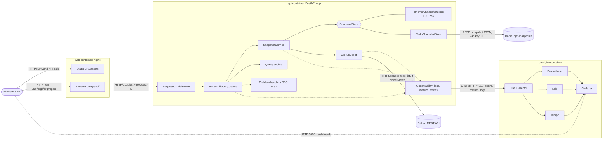
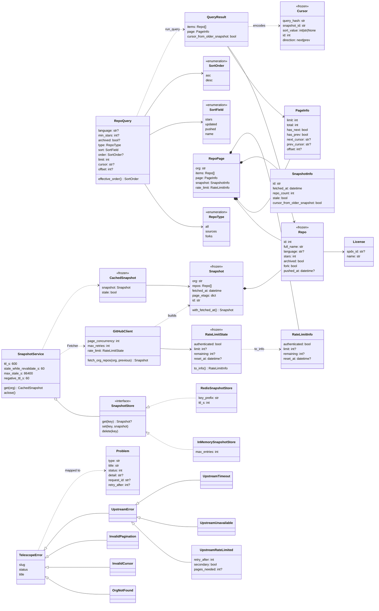
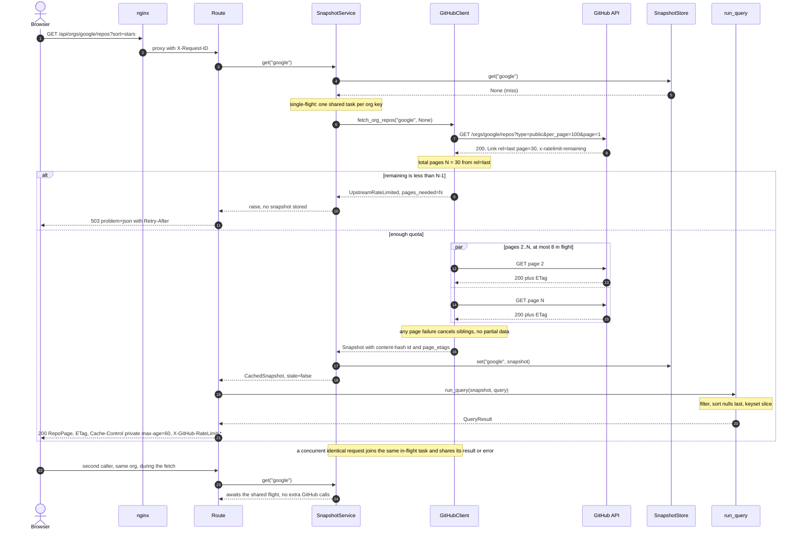
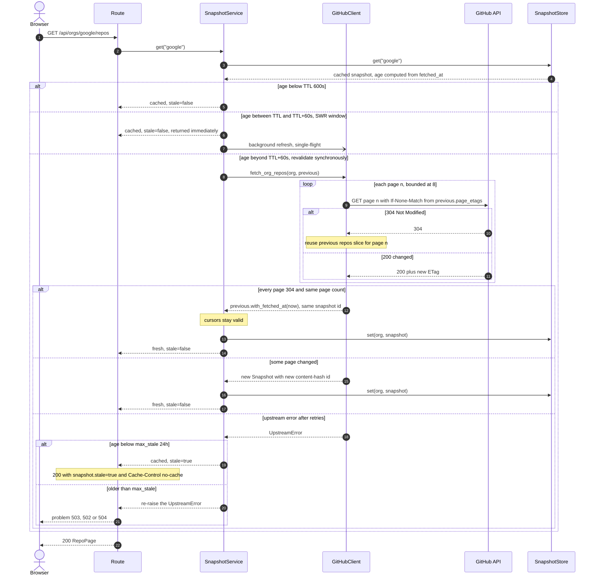
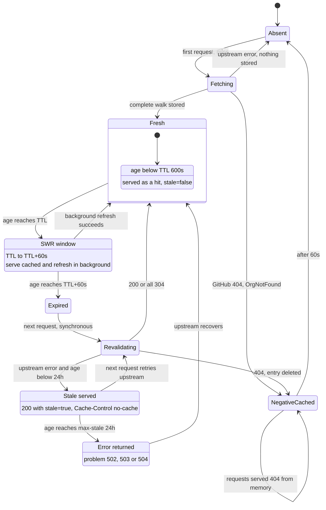
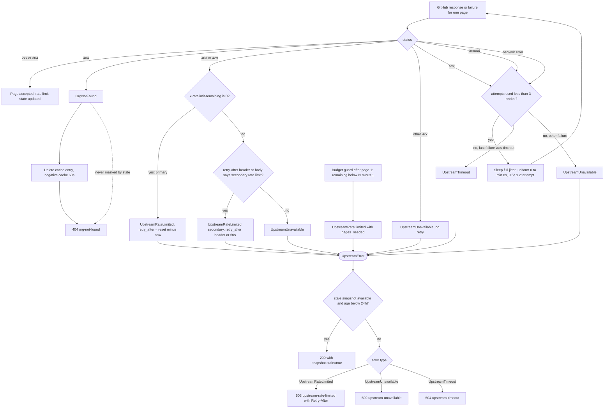
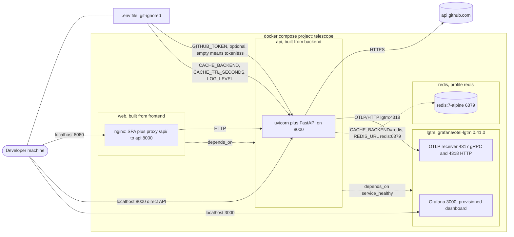
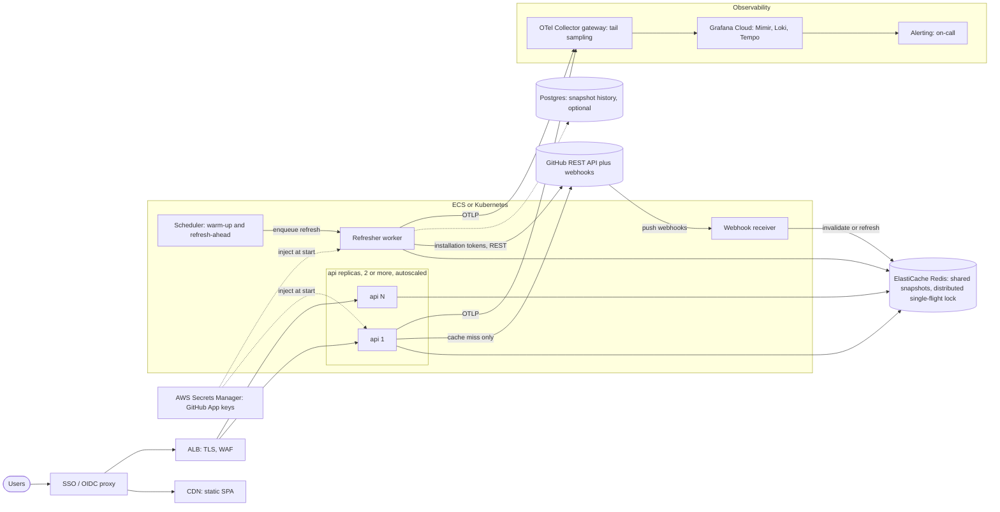

# Telescope: design overview

Telescope serves GET /api/orgs/{org}/repos to a React SPA. GitHub's list endpoint cannot filter by language or stars and cannot sort by stars, so the backend walks every public page of an org once, builds an immutable snapshot, and does all filtering, sorting and pagination in memory.

Requests are cheap once a snapshot exists: a warm request takes about 30ms and costs no GitHub quota. A cold fetch is the expensive path (google: 2,946 repos in 30 pages, 13s tokenless at concurrency 4 and 7.3s with a token at concurrency 8; microsoft: 8,474 repos in 85 pages, 33s at concurrency 4), so most of the design protects that path: single-flight, a budget guard, ETag revalidation, stale-while-revalidate and serve-stale-on-error.

The pieces are layered and depend only downwards through small interfaces: GitHubClient (I/O), SnapshotService over a SnapshotStore (memory or Redis), a pure query engine, then the route. Models and errors are dependency-free, openapi.json is generated from them, and the frontend client is generated from openapi.json.

## Principles

- Contract-first: models.py is the source of truth, openapi.json and the TypeScript types are generated from it, and drift fails a test.
- Fetch once, query locally: upstream call count is independent of client traffic.
- Never cache partial data: a Snapshot exists only for a complete page walk, so a failed fetch stores nothing.
- Degrade to stale rather than fail: any upstream error becomes a 200 with snapshot.stale=true while a copy under 24h old exists.
- The quota is a budget: rate-limit headers are tracked on every response, and a guard refuses a doomed walk after page 1.
- Observable by default: request ids, JSON logs with trace ids, OpenTelemetry metrics and traces, and a provisioned Grafana dashboard.

## Diagrams

### 1. System context and components (Component)

The browser talks only to nginx. nginx serves the SPA and proxies /api/ to the FastAPI app, which holds the cache, the GitHub client and the query engine. Telemetry leaves over OTLP/HTTP to the otel-lgtm container; Redis is an optional shared store.

### 2. Domain model and classes (Class)

The contract types from models.py, the cache and store types, the GitHub client, the query result and cursor, and the error hierarchy that problems.py maps to RFC 9457 responses.

### 3. Cold request (Sequence)

A miss walks page 1, learns the page count from Link rel=last, runs the budget guard, then fetches the remaining pages with at most 8 in flight. Concurrent identical requests share the one in-flight task.

### 4. Refresh, revalidation and stale serving (Sequence)

Inside the SWR window the cached snapshot is returned at once and refreshed in the background. After it, the client revalidates each page with If-None-Match; all 304s keep the same snapshot id. On upstream error a copy under 24h old is served as stale.

### 5. Cache entry lifecycle (State)

Absent, Fetching, Fresh (under 600s), the SWR window (to 660s), Expired, Revalidating, Stale served (under 24h) and the error state beyond max-stale, plus the 60s negative cache for unknown orgs.

### 6. GitHub error classification (Flow)

How github/client.py classifies each GitHub response into a domain error, how retries use full jitter, and how problems.py and the stale rule turn that into a status code.

### 7. Deployment today (Docker Compose) (Deployment)

Four services: web on 8080, api on 8000, lgtm (Grafana 3000, OTLP 4317 and 4318) and an optional redis profile. GITHUB_TOKEN flows from .env into the api container only.

### 8. Target production deployment (Deployment)

SSO in front of a CDN and ALB, at least two autoscaled api replicas, ElastiCache Redis for shared snapshots and a distributed lock, a refresher worker with a scheduler, GitHub App tokens from Secrets Manager, webhook invalidation, and an OTel gateway to Grafana Cloud.

## Decisions

| ADR | Decision | Revisit when |
|---|---|---|
| 0001 | Monorepo, layered backend, Makefile plus mise | A second team or a deploy target appears: add a CI workflow that calls the same make targets. |
| 0002 | Fetch all pages, then filter locally | Orgs get so large that the cold walk or the memory is unacceptable: move to a background refresher with a 202 and progress, or to Postgres. |
| 0003 | Snapshot cache with SWR, single-flight and stale-on-error | More than one replica runs: move the lock and negative cache to Redis and add a circuit breaker. |
| 0004 | Keyset cursors by default, offset as an alternative | Clients need stable deep links to a position across refreshes: persist snapshots (Postgres) and pin cursors to a snapshot. |
| 0005 | Null and missing-data semantics | A nullable sort key needs different placement semantics, or GitHub starts distinguishing empty from null. |
| 0006 | RFC 9457 problems, 503 for upstream limits, jittered retries | We add per-user rate limiting, which would use 429 for our own callers. |
| 0007 | Optional token with a pre-flight budget guard | Several tokens or a GitHub App are available: replace the single remaining counter with a per-token budget scheduler. |
| 0008 | Secrets from the environment, redacted everywhere | The service is deployed for real: GitHub App installation tokens that rotate hourly and a *_FILE style mount. |
| 0009 | OpenTelemetry to otel-lgtm, a metrics facade, JSON logs | Production: replace otel-lgtm with a Collector gateway to a managed backend and add browser RUM. |
| 0010 | FastAPI-generated contract and a generated typed client | The API has outside consumers: version it under /api/v1 and add Schemathesis in CI. |
| 0011 | Fast, offline, parallel-safe tests | CI exists: add Schemathesis and Playwright against compose. |

### ADR-0001: Monorepo, layered backend, Makefile plus mise

**Decision.** One repo with backend, frontend, infra and docs. The backend is layered client, cache service, pure query engine, route, each depending only downwards on small interfaces (Fetcher, SnapshotStore). models.py and errors.py are dependency-free. A Makefile holds the real targets and mise pins tool versions and aliases them.

**Why.** A timeboxed take-home run locally needs one clone, one command per task and atomic contract changes. Dependency-free models let the client, cache and query engine be tested in isolation.

**Alternatives considered**

- Polyrepo: ceremony for one API and one UI.
- Flask or Django: sync by default and no generated contract.
- Next.js: SSR adds a server runtime nobody needs.
- mise only or Make only: Make does not pin versions, mise tasks are less portable.

**Trade-offs**

- No CI, so nothing blocks a bad push; checks are make targets the reviewer runs.
- Make is awkward on Windows.
- Two lockfiles (uv.lock, pnpm-lock.yaml) to keep committed.

**Revisit when.** A second team or a deploy target appears: add a CI workflow that calls the same make targets.

### ADR-0002: Fetch all pages, then filter locally

**Decision.** Walk GET /orgs/{org}/repos?type=public&sort=full_name&direction=asc&per_page=100 once per org: page 1, read rel=last, then pages 2..N with a semaphore of 8 under a TaskGroup. All filtering, sorting and pagination happen on the in-memory snapshot. The API type parameter is a local filter on the fork flag.

**Why.** GitHub cannot filter by language or stars or sort by stars. Search is capped at 1,000 results, allows 10 requests a minute tokenless and has no language:none. GraphQL needs a token. Fetching all once costs about 30 calls for google and then zero per client request. sort=full_name keeps page boundaries stable, which makes per-page ETags useful.

**Alternatives considered**

- Pass-through to GitHub: no language, stars or star sorting.
- Search API: 1,000-result cap and 10 requests a minute.
- GraphQL: requires a token, excludes tokenless use.
- Serial page walk: safest, but about 30 round trips.

**Trade-offs**

- Cold requests are slow: measured 1 to 1.5s per page, so google took 13s tokenless at concurrency 4 and 7.3s with a token at concurrency 8, and microsoft (85 pages) took 33s at 4.
- Concurrency deliberately deviates from GitHub's serial-requests advice; the default was raised from 4 to 8 after measuring and is a setting (1 restores serial).
- Memory is O(repos per org) per cached org.
- Data can be a TTL old.

**Revisit when.** Orgs get so large that the cold walk or the memory is unacceptable: move to a background refresher with a 202 and progress, or to Postgres.

### ADR-0003: Snapshot cache with SWR, single-flight and stale-on-error

**Decision.** SnapshotService over a SnapshotStore Protocol. Under 600s is a hit. From 600s to 660s it returns the cached snapshot and refreshes once in the background. Beyond that it revalidates synchronously with per-page If-None-Match; all 304s keep the same snapshot id with a new fetched_at. Any UpstreamError serves the cached copy with stale=true while it is under 24h old. One shared task per org coalesces concurrent misses. An unknown org is negative-cached for 60s. Our responses carry a weak ETag and Cache-Control private, max-age=60 (no-cache when stale).

**Why.** One cold fetch costs about 30 requests against a 60 an hour tokenless budget, so steady state must cost nothing and an outage must not become an error page. Warm requests measured about 30ms.

**Alternatives considered**

- Redis only: extra infrastructure for a local demo.
- No SWR: users would wait on every refresh.
- Fail on upstream error: turns a rate limit into an outage.
- No single-flight: N concurrent misses become N walks.

**Trade-offs**

- Unauthenticated 304s still count against the limit (observed x-ratelimit-used 10 to 11), so ETag revalidation saves quota only with a token.
- Single-flight and the negative cache live in process memory, so each replica coalesces separately.
- The SWR window returns stale=false for data up to 60s past TTL.
- While upstream is down, every request past the SWR window retries GitHub, because nothing records the failure.

**Revisit when.** More than one replica runs: move the lock and negative cache to Redis and add a circuit breaker.

### ADR-0004: Keyset cursors by default, offset as an alternative

**Decision.** Cursor is base64url JSON carrying a version, a query hash, the snapshot id, the (sort value, id) key and a direction. Position is found by bisect over sort-key tuples, so it works even if the key row is gone. The query hash excludes limit, cursor and offset, so page size can change mid-walk. A snapshot id mismatch still continues and sets cursor_from_older_snapshot. offset (0 to 100,000) is mutually exclusive with cursor (400 invalid-pagination) and returns null cursors.

**Why.** A keyset position is stable under inserts and deletes before it and costs O(log n). The snapshot id is a content hash, so a revalidation that changed nothing keeps cursors current. Failing every in-flight user at each refresh would be worse than a flagged imperfection.

**Alternatives considered**

- Offset only: rows are skipped or repeated when data shifts.
- page and per_page: offset with other arithmetic, cut for time.
- Reject cursors from older snapshots: breaks users at every refresh.

**Trade-offs**

- No jump-to-page for cursor mode; offset mode exists for that and may duplicate or skip rows across a refresh.
- Cursors are not signed; tampering only affects the tamperer.
- A changed sort key (stars) can move a row across snapshots, which is flagged rather than hidden.

**Revisit when.** Clients need stable deep links to a position across refreshes: persist snapshots (Postgres) and pin cursors to a snapshot.

### ADR-0005: Null and missing-data semantics

**Decision.** Normalise at ingestion: empty strings become null, NOASSERTION licence ids become null, topics default to []. Sorting uses a tuple key (is_null, directed value, id) so nulls sort last in both directions and id ascending is the tiebreaker. language=none matches repos with no language, and language matching is case-insensitive. Names compare with casefold().

**Why.** Keyset pagination needs a total, deterministic order. One spelling of no value keeps every layer and the UI simpler, and nulls first would put unknown dates at the top of a newest-first list.

**Alternatives considered**

- Pass GitHub values through: two spellings of nothing.
- SQL-style nulls that flip with direction.
- Search-style language:none: does not exist upstream.

**Trade-offs**

- A language literally named None would be unreachable by name.
- Collapsing empty and null loses a distinction GitHub may draw.
- The custom comparison is more code than sorted(reverse=True).

**Revisit when.** A nullable sort key needs different placement semantics, or GitHub starts distinguishing empty from null.

### ADR-0006: RFC 9457 problems, 503 for upstream limits, jittered retries

**Decision.** Every error is application/problem+json with a type slug, request_id and extensions. Upstream rate limits (primary, secondary, budget guard) are 503 with Retry-After; other GitHub failures are 502, timeouts 504, an unknown org 404, bad cursors 400, validation 422. Only 5xx, timeouts and transport errors are retried, up to 3 times with delay uniform(0, min(8s, 0.5s x 2^attempt)). Rate limits are not retried in-request. A failure on any page fails the whole fetch.

**Why.** The frontend should branch on type and status, never on message text. 429 means the caller is sending too much; here our shared upstream quota is exhausted, so 503 with Retry-After is the honest signal and 429 stays free for limiting our own callers.

**Alternatives considered**

- Ad-hoc error JSON or FastAPI default detail: inconsistent shapes.
- Forward GitHub's 403: means the caller is forbidden.
- Return 429 for upstream limits.
- Retry everything: hammers GitHub and burns quota.

**Trade-offs**

- 503 departs from the obvious 429; the reason is documented.
- Clients that treat 502, 503 and 504 differently must read the slug.
- Jitter makes tests random unless rng and sleep are injected, which they are.

**Revisit when.** We add per-user rate limiting, which would use 429 for our own callers.

### ADR-0007: Optional token with a pre-flight budget guard

**Decision.** GITHUB_TOKEN is optional. Rate-limit state is updated from every response, including 304s and errors, keeping the lowest remaining within one reset window because concurrent pages finish out of order. After page 1, if remaining is known and below N minus 1, the client raises UpstreamRateLimited with pages_needed and Retry-After before fetching pages 2..N. A primary limit is 403 or 429 with remaining 0; a secondary limit is retry-after or the body text, never retried.

**Why.** Tokenless is 60 requests an hour and google needs about 30, so about two cold fetches an hour. Failing fast with an actionable Retry-After beats burning quota on a walk that cannot finish. In the end-to-end run, microsoft with 17 requests left was refused with pages_needed 85 after one request.

**Alternatives considered**

- Require a token: the app would not run out of the box.
- Fetch and hope: a mid-walk limit wastes the spent quota and caches nothing.
- Own quota accounting: duplicates the headers.

**Trade-offs**

- Tokenless use is fragile for big orgs; cached or stale data hides it for orgs already fetched.
- The guard trusts the last known remaining, which can be stale when processes share an IP.
- The guard costs one request when it trips.
- ADR text still says concurrency is capped at 4; the default is now 8.

**Revisit when.** Several tokens or a GitHub App are available: replace the single remaining counter with a per-token budget scheduler.

### ADR-0008: Secrets from the environment, redacted everywhere

**Decision.** Settings reads GITHUB_TOKEN as a SecretStr, and a blank value means tokenless. The token is used in one place, the Authorization header of the GitHub client. A logging filter redacts the token and Authorization or Bearer text. .env is git-ignored with a committed .env.example. Production injects the variable from a secrets manager. A fine-grained, read-only, public-repositories PAT is the recommended scope.

**Why.** A leak must be impossible through git, logs, responses or the bundle, and the app must start with no token. We only read public data, so even a leaked token reads nothing the world cannot.

**Alternatives considered**

- Committed config or baked images: leak through history and layers.
- Compose secrets files: needs a file-reading path for little gain.
- Token supplied by the browser: puts a credential in the frontend.

**Trade-offs**

- Environment variables are visible to anyone who can inspect the container.
- Redaction is pattern based, so an encoded token would slip through; the code avoids logging credentials at all.
- No rotation story beyond replacing the variable and restarting.

**Revisit when.** The service is deployed for real: GitHub App installation tokens that rotate hourly and a *_FILE style mount.

### ADR-0009: OpenTelemetry to otel-lgtm, a metrics facade, JSON logs

**Decision.** Programmatic OTel setup that is a no-op unless OTEL_EXPORTER_OTLP_ENDPOINT is set, exporting OTLP/HTTP to grafana/otel-lgtm 0.41.0. A metrics facade (cache_lookup, github_request, github_rate_limit, upstream_fetch) keeps OTel out of business code. JSON logs carry request_id, trace_id and span_id, and a request-id middleware echoes X-Request-ID. A provisioned Grafana dashboard covers HTTP, cache, GitHub calls, rate limit, logs and traces.

**Why.** The reviewer should see cache hits, upstream calls and the quota with one make up, with click-through from logs to traces. The facade makes metrics free in tests.

**Alternatives considered**

- Separate Prometheus, Loki, Tempo and Grafana services: more YAML for no benefit.
- The zero-code instrument agent: less explicit and fights uvicorn reload.
- structlog: more bridging to stdlib and uvicorn.
- Browser OTel: bundle weight and CORS for little gain.

**Trade-offs**

- Python OTel logs are not stable, so versions are pinned and stdout JSON remains.
- Metric names depend on Prometheus translation and the semconv opt-in.
- otel-lgtm data is ephemeral.
- No frontend telemetry.

**Revisit when.** Production: replace otel-lgtm with a Collector gateway to a managed backend and add browser RUM.

### ADR-0010: FastAPI-generated contract and a generated typed client

**Decision.** openapi.json is exported deterministically from the Pydantic models and committed. openapi-typescript generates schema.d.ts and openapi-fetch wraps it. Error responses are post-processed to application/problem+json so errors are typed as Problem. Two drift checks run locally: a pytest compares the export with the committed file, and pnpm gen:api:check compares the generated types.

**Why.** One source of truth with each hop checked: code to openapi.json to schema.d.ts. A types-only client has the least generated code to review.

**Alternatives considered**

- Hand-written OpenAPI: drifts.
- orval: more machinery than one GET needs.
- hey-api: pre-1.0.

**Trade-offs**

- A contract change needs make gen-client and two committed files.
- Types are not a runtime validator; responses are trusted.
- FastAPI or Pydantic upgrades produce spec diffs.
- The problem+json rewrite is a small hack over FastAPI.

**Revisit when.** The API has outside consumers: version it under /api/v1 and add Schemathesis in CI.

### ADR-0011: Fast, offline, parallel-safe tests

**Decision.** pytest with -n auto, respx at the transport level with a fixture builder that produces real Link and rate-limit headers, and injected now, sleep and rng so TTL, SWR and backoff are instant and deterministic. The query engine is tested with pure table-driven and seeded property-style walks. The frontend uses Vitest with MSW handlers typed from the same paths type. The suite is 162 backend and 14 frontend tests.

**Why.** Tests must not depend on the network or on 60 requests an hour, and must not share state because agents work in parallel.

**Alternatives considered**

- The real GitHub API in tests: slow, flaky and burns quota.
- Patching httpx: couples tests to internals.
- Hypothesis: extra dependency.
- Serial runs.

**Trade-offs**

- respx fixtures encode our belief about GitHub; one manual live check mitigates that.
- Injecting clocks adds constructor parameters.
- Seeded walks have no shrinking.
- No browser end-to-end tests.

**Revisit when.** CI exists: add Schemathesis and Playwright against compose.

## Production roadmap

### Topology and scaling

**Now.** One process by default with an in-memory LRU of 256 orgs. A Redis store exists for sharing snapshots, but single-flight and the negative cache are per process, so replicas can each refresh the same org.

**Next**

- Run at least two api replicas behind a load balancer, autoscaled on CPU and request latency.
- Make Redis the default store and add a distributed single-flight lock: SET key NX PX with a TTL a little above the cold-fetch time, losers poll the snapshot key (or a pub/sub channel) with a bounded wait, then fall back to fetching on timeout.
- Move the 60s negative cache into Redis.
- Size memory: about 8.5k repos (microsoft) is a few MB of JSON per org; set maxmemory with an allkeys-lru policy and alert on evictions.
- Keep filtering in memory while orgs stay under tens of thousands of repos; move to Postgres or SQL with indexes on (language, stars) once snapshots are persisted for history or the in-memory sort shows up in p95.

**Why.** Today's per-process state is fine for one container and wrong for two.

### Data freshness

**Now.** Refresh happens on demand: a request past TTL plus the 60s SWR window waits for revalidation, and a request inside the window triggers one background refresh.

**Next**

- A refresher worker driven by a scheduler that refreshes entries before they expire (refresh-ahead) so users never see a synchronous revalidation.
- Warm-up of popular orgs at deploy time.
- GitHub webhooks (repository events) to invalidate or refresh the affected org immediately, with the TTL as the safety net.
- For huge cold orgs, return 202 with progress, or stream the first page of results while the walk continues, instead of holding the request for 30 seconds.

**Why.** A 13 second cold request is acceptable for a demo and not for a product.

### GitHub access

**Now.** One optional personal access token, 5,000 requests an hour with it and 60 without. Concurrency is a fixed 8.

**Next**

- Use a GitHub App: installation tokens are short lived, rotate automatically and have their own per-installation limits.
- Add a token pool with a per-token budget scheduler that picks the token with the most remaining quota.
- Treat secondary limits as feedback: on a secondary-limit response or Retry-After, lower page concurrency adaptively and recover slowly.

**Why.** One shared token is a single point of exhaustion.

### Security

**Now.** Public, unauthenticated API for local use. The token is a SecretStr with log redaction, and CORS allows only GET from configured origins.

**Next**

- SSO through an OIDC proxy in front of the SPA and API, since this is an internal tool.
- Per-user rate limiting on our API with a Redis token bucket, returning 429.
- Inject secrets at runtime from AWS Secrets Manager, Doppler or 1Password.
- CSP and security headers at nginx or the CDN.
- Distroless, non-root, read-only-filesystem images, signed with cosign and shipped with an SBOM; Renovate for dependency updates.
- Kubernetes network policies allowing api to reach only Redis, the collector and api.github.com.

**Why.** Moving from a local demo to a shared service changes who can call it.

### Reliability

**Now.** Retries with full jitter, a pre-flight budget guard, timeouts of 10s per request and serve-stale for up to 24h. There is no memory of a recent upstream failure, so each request past the SWR window retries.

**Next**

- Define SLOs: warm p95 under 150ms and 99.9% availability.
- Add a circuit breaker around GitHub so an outage stops costing a retry cycle per request.
- Set explicit timeout budgets from the route down to each page, and bulkhead the refresher from request serving.
- Chaos tests for upstream outages, 5xx storms and slow responses, asserting stale serving.
- Graceful degradation stays stale-first.

**Why.** Stale-on-error is the best feature of the cache; a breaker makes it cheaper.

### Observability

**Now.** Metrics, traces and JSON logs reach an otel-lgtm container with a provisioned dashboard. Ephemeral and local.

**Next**

- An OTel Collector gateway with tail sampling that keeps error and slow traces.
- Retention policies per signal.
- Alerts: rate-limit remaining under 10%, stale-serve ratio, 5xx burn rate, eviction count.
- Browser RUM tied to the backend with trace context.
- Exemplars linking latency histograms to traces.

**Why.** Dashboards help when someone is looking; alerts help when they are not.

### Delivery

**Now.** No CI by decision. make lint and make test run formatters, type checks, 162 backend and 14 frontend tests and both contract drift checks.

**Next**

- CI pipeline: lint, tests, contract drift, Schemathesis against the ASGI app, Playwright end-to-end against compose, image build and vulnerability scan.
- Preview environments per pull request.
- Canary releases with automatic rollback on the SLO burn rate.
- Infrastructure as code with Terraform.
- Version the API under /api/v1 with a published deprecation policy.

**Why.** The checks exist; they only need a trigger.

### Product

**Now.** Browse one org's repositories with language, stars, archived and type filters, sorting, and cursor or offset paging.

**Next**

- Stars-over-time history from Postgres snapshots.
- Compare several orgs side by side.
- Saved views.
- CSV export of the filtered list.
- Multi-value language filters.

**Why.** Snapshots are already complete and content-hashed, which makes history cheap to persist.
